#+title: orpheus.el
#+subtitle: a music player for Emacs with pluggable backends
#+author: Josep Bigorra
#+email: jjbigorra@gmail.com
#+language: en
#+options: toc:nil num:nil

[[https://jointhefreeworld.org/ggg/dist/emacs-lisp.svg]] [[https://jointhefreeworld.org/ggg/dist/license-mit.svg]]

#+attr_html: :width 160
#+attr_org: :width 160
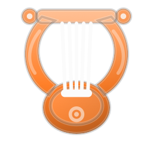

/orpheus/ is the singer who could charm stones and rivers; this one charms a
music daemon, or mpv, from inside Emacs.

#+attr_html: :width 640
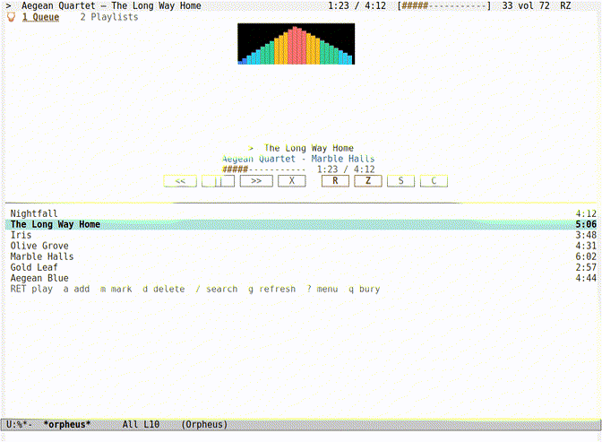

The six player themes, the media controls, every tab, four library views, the
compact and cover layouts and the Ember and Ice visualizer ramps, recorded
reproducibly with =maak demo=.  Stills:
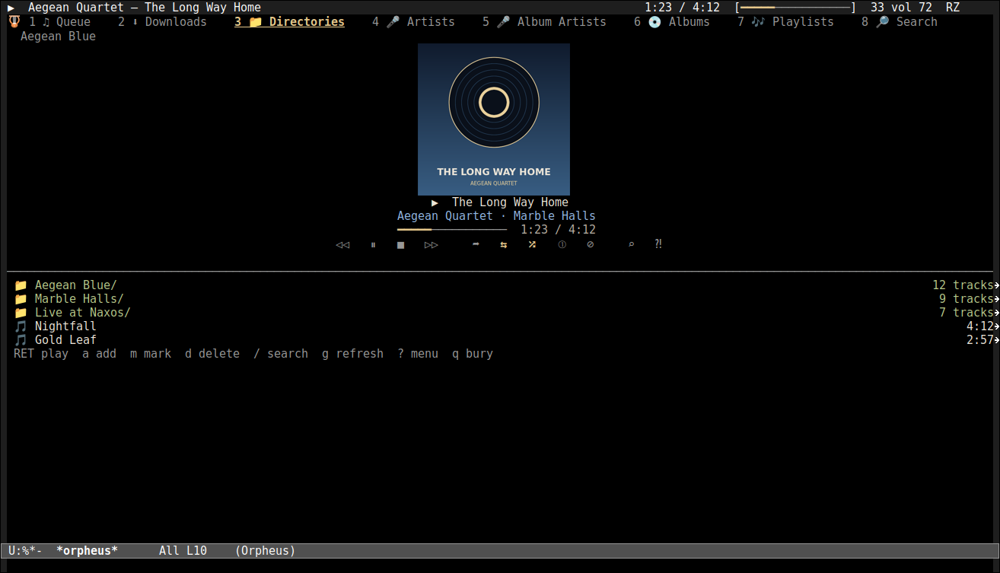, 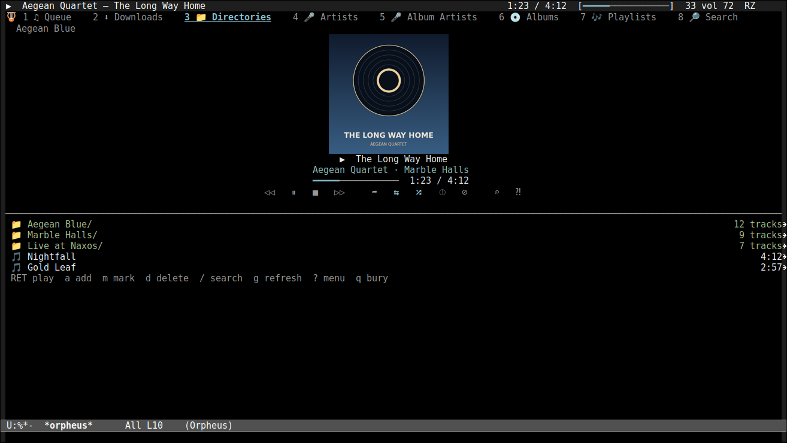,
,
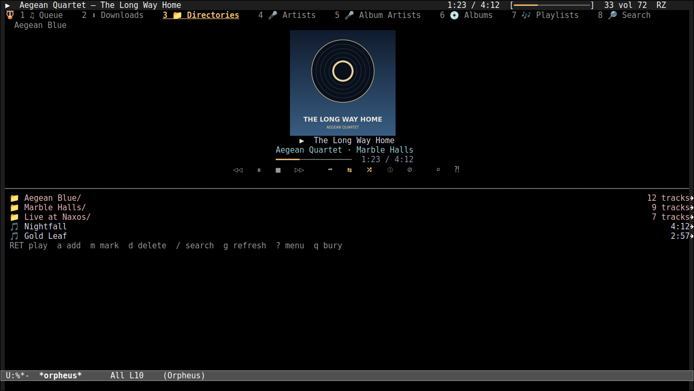,
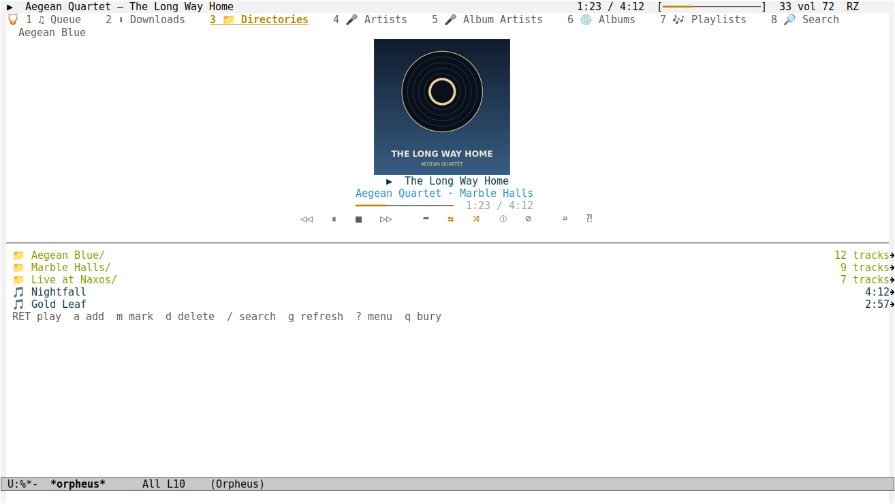,
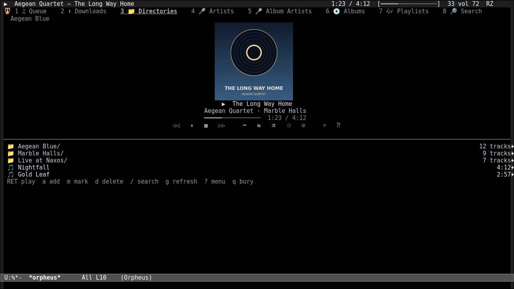,
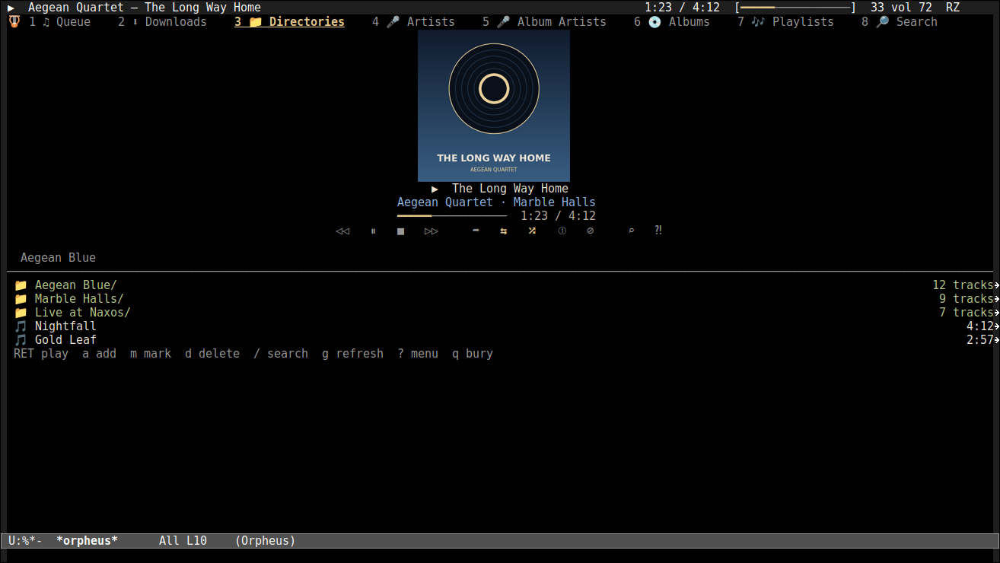 and 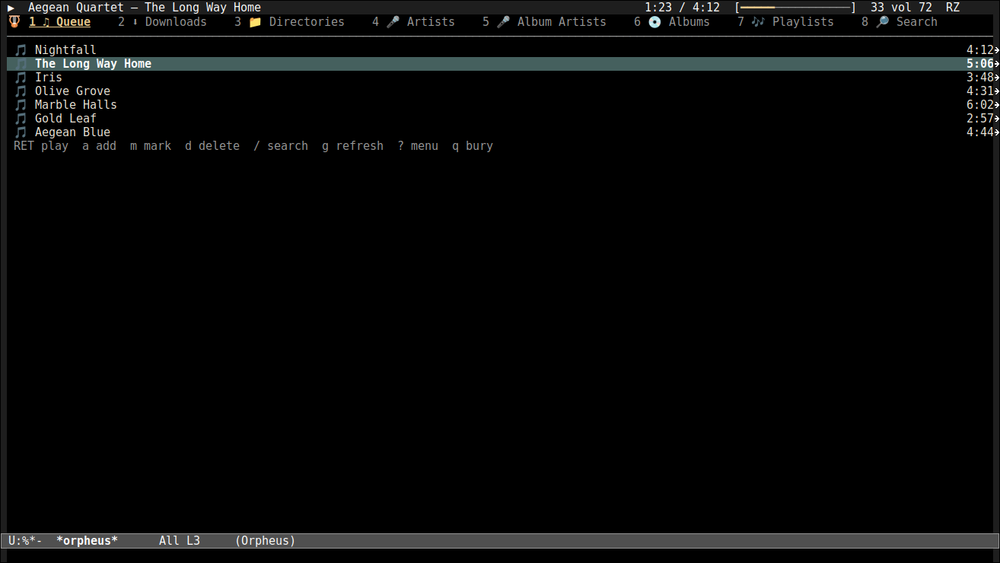
layouts, and the 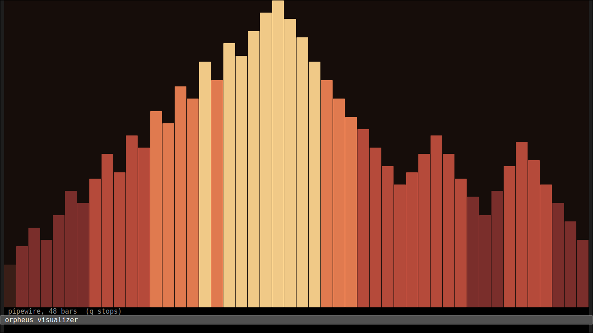 and
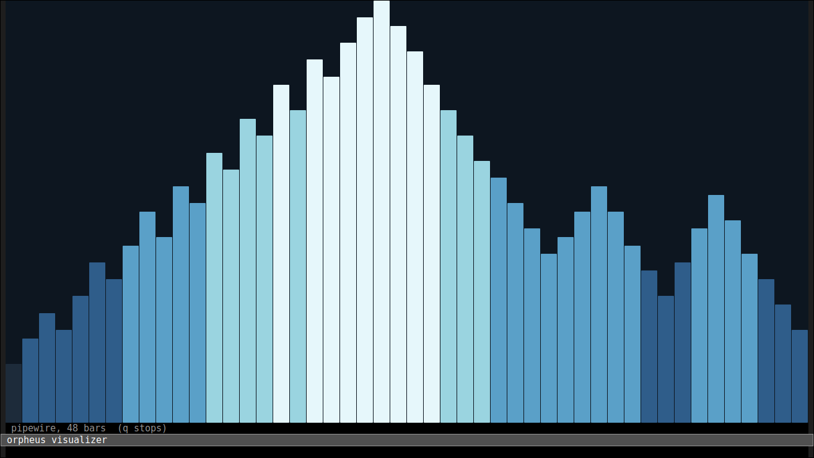 ramps.

*orpheus.el is a flexible music player for Emacs*: a queue, a couple of tabs, a
library, playlists, cover art, an equalizer you can shape with the mouse or the
keyboard, lyrics that follow the music and a spectrum visualizer, with the keys
Emacs fingers already know.  MPD, local files and music on another machine all appear
in the same interface, and ~B~ switches between them without restarting Emacs.

New here?  You do not need to learn everything at once.  Pick the backend that
matches where your music already lives, install its program, and run
~M-x orpheus~.  Press ~2~ for the files tab, ~RET~ to open a folder or play a
track, and ~H~ whenever you want the map.  The [[file:docs/glossary.org][glossary]] explains every word
below in plain language.

Everything orpheus does is asynchronous.  Replies arrive in process filters and
the status is read on a timer, so a slow server, a starting player or a hanging
stream never blocks the editor.  The SSH backend streams downloads straight to
disk, runs a small queue with background prefetch and keeps recent tracks
cached, so a slow link does not stop the interface.  The list is read when
something changed, not on every tick, so a queue of thousands costs nothing
while it plays.  The interface is text, so it is the same in a terminal, in a
graphical frame and over SSH; in a frame that can draw, it adds cover art, an
SVG visualizer and a small logo, and in one that cannot, nothing breaks.  Six
player themes, five visualizer ramps and four layouts are one key away, and
the layout is a plain list when you want your own.

* Documentation

The full guide lives in [[file:docs/index.org][docs/]].  Start with the page that
matches what you are doing; every page links back here and to its neighbours.

| Page | What it covers |
|------+----------------|
| [[file:docs/features.org][Feature tour]] | the tabs, transfer queue, now-playing card, playlists, equalizer, lyrics and visualizer |
| [[file:docs/architecture.org][How it works]] | the backend seam, Mermaid diagrams, formats and the platform matrix |
| [[file:docs/usage.org][Using orpheus]] | a working backend, MPD passwords, the keys and the graphical fallbacks |
| [[file:docs/glossary.org][Words and ideas]] | a friendly glossary of backends, queues, tabs, caches and the rest |
| [[file:docs/configuration.org][Configuration]] | every option, its default and complete examples |
| [[file:docs/backends.org][Backends]] | MPD, local files, SSH, the backend protocol and platform notes |
| [[file:docs/troubleshooting.org][Troubleshooting]] | what to check when the player is silent, a password is rejected or a download stalls |
| [[file:docs/development.org][Development]] | the gate, the test suites, the demo and the release |

* Install

*** From a checkout

#+begin_src emacs-lisp
(add-to-list 'load-path "/path/to/orpheus.el")
(require 'orpheus)
#+end_src

*** With straight.el

#+begin_src emacs-lisp
(straight-use-package
 '(orpheus :type git :host github :repo "jjba23/orpheus.el"))
#+end_src

*** With use-package

#+begin_src emacs-lisp
(use-package orpheus
  :load-path "/path/to/orpheus.el"
  :commands (orpheus orpheus-visualizer)
  :config
  (setq orpheus-backend 'mpd)
  (orpheus-mode-line-mode 1))
#+end_src

The package itself is Emacs Lisp.  Each backend calls a program, and which
machine that program lives on is the part worth checking:

| Program   | Where                          | Needed for                                              |
|-----------+--------------------------------+---------------------------------------------------------|
| ~emacs~     | this computer                  | Emacs 29.1 or newer                                     |
| ~mpd~       | the machine running the daemon | the MPD backend                                         |
| ~mpv~       | this computer                  | the local and SSH backends play through it              |
| ~ffmpeg~    | this computer                  | covers, lyrics tags, and a disc track fetched as a range |
| ~ffmpeg~    | the SSH host                   | cutting a disc track on the host when it has one         |
| ~ssh~       | this computer                  | the SSH backend                                         |
| ~sftp~      | this computer                  | the SSH backend when the host's shell cannot run ~cat~   |
| ~cava~      | this computer                  | the visualizer                                          |
| ~yt-dlp~    | this computer                  | video links played by the local backend                 |

Cue sheets need no program: a ~.cue~ beside an image is read in Emacs, and the
local backend also falls back to the ~CUESHEET~ block inside a FLAC file.  A
missing ~ffmpeg~ on the SSH host does
not mean copying the whole image: a track of a FLAC image is fetched as the
byte range its seek table names, or estimated from the average bitrate when
there is none, and cut here with this computer's ~ffmpeg~; ~ffprobe~ corrects
an estimate.  Only an image that cannot be planned that way is copied once,
and every track of it plays from that copy.  ~orpheus-ssh-split-images~ turns
the range path off.

Audio and video are the common containers mpv opens: MP3, FLAC, Ogg and Opus,
M4A and AAC, WAV, AIFF, WMA, ALAC, APE, WavPack, DSD, MIDI and more; MP4, MKV,
WebM, AVI, MOV, MPEG and TS, FLV, WMV, VOB and 3GP among video.  A video plays
its sound only: mpv starts with ~--no-video~.  The list is
~orpheus-local-extensions~; MPD uses the formats its daemon supports.
[[file:docs/architecture.org][How it works]] has the format table and the platform matrix.

* Quick start

A daemon on this machine, reached over its socket:

#+begin_src emacs-lisp
(require 'orpheus)
(setq orpheus-backend 'mpd)
(setq orpheus-mpd-socket "~/.mpd/socket")
(orpheus)
#+end_src

The local backend needs no daemon:

#+begin_src emacs-lisp
(setq orpheus-backend 'local)
(setq orpheus-local-directory "~/Music")
(orpheus)                                  ; then 2 for the files tab, RET to play
#+end_src

Music on another machine is copied over ssh and played by mpv here:

#+begin_src emacs-lisp
(setq orpheus-backend 'ssh)
(setq orpheus-ssh-host "music.example.org")   ; or "me@music.example.org"
(setq orpheus-ssh-directory "Music")          ; nil starts in the login home
(orpheus)
#+end_src

The complete walkthrough, including MPD passwords, SSH keys and the queue's
behavior, is in [[file:docs/usage.org][Using orpheus]].  If you are not sure which backend fits,
the [[file:docs/usage.org#choose-a-backend][backend chooser]] asks the question in plain language.  For a quick
answer without leaving the player, ~?~ opens the menu and ~H~ opens the help
buffer.

* Why orpheus is built this way
:PROPERTIES:
:CUSTOM_ID: why-orpheus
:END:

orpheus keeps the interface and the music source apart.  The queue, the tabs,
the keys and the drawing do not know whether the music comes from a daemon on
this machine, a folder of files, or another computer.  That separation is what
lets one player feel the same everywhere, and what makes a new backend a
small, testable piece instead of a rewrite.

- *The backend is the seam.* :: The queue, the tabs, the keys and the drawing
  know nothing about MPD or mpv. They call ~orpheus-backend-status~,
  ~orpheus-backend-browse~ and ~orpheus-backend-command~; a new backend
  implements those and appears in the same interface, unchanged.
- *Nothing blocks.* :: No synchronously read socket and no
  ~shell-command-to-string~ in the path of the interface. MPD replies are
  parsed as they arrive, mpv speaks JSON over its IPC socket, the ssh backend's
  listings and downloads are processes with sentinels, and cava's frames are
  read by a filter while you keep typing.
- *One interface, two worlds.* :: Plain text, faces and a keymap. A terminal
  loses pictures and nothing else, and ~orpheus-ui-plain-ascii~ loses the
  Unicode for fonts that do not have it.
- *Platforms are the player's problem.* :: MPD owns its audio output, and mpv
  picks PipeWire, CoreAudio or WASAPI. orpheus asks for the right one and stays
  out of the way; only the visualizer needs to know what the system captures
  with.
- *MIT, and no dependencies.* :: Emacs built-ins alone, including the SVG
  drawing. There is nothing to install for the package itself; the backend
  programs are tools you install separately.
- *Tested against real players.* :: The unit suite runs with no daemon at all
  (it starts a fake MPD on a loopback port), and the integration suite starts a
  real MPD and a real mpv and plays through them.

* License

MIT.  The full text is in [[file:LICENSE]], and every source file carries an
~SPDX-License-Identifier: MIT~ line.  History lives in [[file:NEWS.org]].
